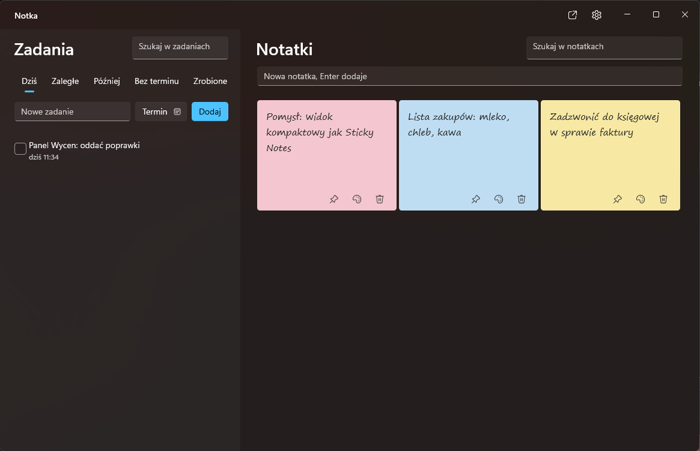
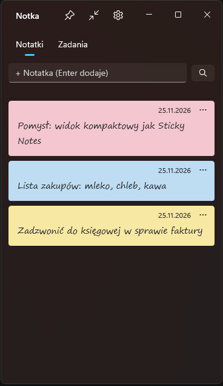
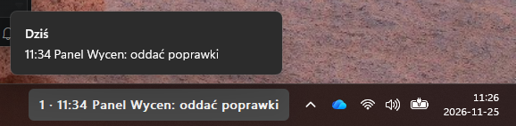
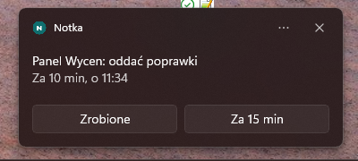

# Notka

Private tasks and sticky notes for Windows 11, with a live summary next to the taskbar clock and an MCP server for AI agents. The app UI is in Polish.



## Features

- **Tasks** with due dates and Today, Overdue, Later, No date and Done views, plus search.
- **Sticky notes** with colors, pinning and search, and a compact window in the style of Windows Sticky Notes.
- **Taskbar strip** next to the clock: today's tasks at a glance, a hover card with the list, on one or all monitors, text only or with a background, hidden together with an auto-hidden taskbar.
- **Reminders** as Windows notifications: 15 minutes before a task that has a time (Done and Snooze buttons), and a morning summary (from 9:00) of tasks that only have a date and of overdue ones.
- **AI agents**: a bundled MCP server lets Claude Desktop, Claude Code, Cursor and others add and read tasks and notes. A setting switches it off.
- **Updates** from GitHub Releases, installed on click, with a checksum check and rollback.
- **Local only**: data lives in a SQLite file, and the API listens on `127.0.0.1` behind a per-launch token.

| Compact window | Taskbar strip | Reminder |
|---|---|---|
|  |  |  |

## Install

1. Download `Notka-win-x64.zip` from [Releases](https://github.com/Dejvis000/notka/releases) and extract it to a folder you can write to (not `C:\Program Files`).
2. Run `Notka.exe`; the program files live in the `app` folder. Windows 11 x64 is required, .NET is not.

The app is not code-signed, so SmartScreen may warn on first launch. Closing the window hides Notka to the tray; use Exit in the tray menu or in Settings to quit.

## AI agents

In Settings, "Copy prompt" copies instructions you paste into an agent's chat; the agent registers the `notka` server itself. To do it by hand, add this to the agent's MCP configuration (the file is `app\Notka.Mcp.exe`):

```json
{
  "mcpServers": {
    "notka": { "command": "C:\\path\\to\\Notka.Mcp.exe" }
  }
}
```

Tools: `add_task`, `list_tasks`, `search_tasks`, `complete_task`, `update_task`, `create_note`, `list_notes`. Notka must be running.

## Updates

Notka checks GitHub Releases once a day and from Settings (anonymous request to `api.github.com`; the daily check can be turned off). Installing downloads the package, verifies its SHA-256 from the same release, replaces the files and restarts. A failed copy is rolled back; details are in `%LOCALAPPDATA%\Notka\update\update.log`. Running MCP servers from the install folder are stopped during the update, so restart your agent afterwards.

## Build from source

Requires Windows 11 and the .NET SDK 10.

```
dotnet build Notka.sln
dotnet test --solution Notka.sln
dotnet run --project src/Notka.Desktop -p:Platform=x64
```

Release package:

```
dotnet publish src/Notka.Mcp -c Release -r win-x64 --self-contained -o artifacts/desktop
dotnet publish src/Notka.Desktop -c Release -r win-x64 -p:Platform=x64 --self-contained -o artifacts/desktop
```

Pushing a `vX.Y.Z` tag makes GitHub Actions build, test and publish a release; its notes come from `release-notes/vX.Y.Z.md`.

## Configuration

Data is stored in `%LOCALAPPDATA%\Notka` (`notka.db`, `settings.json`, `reminders.json`, `logs`). Keys with `:` are set as environment variables with `__` instead (`Notka__DbPath`).

| Setting | Meaning |
|---|---|
| `Notka__Port` | API port, default `5123` |
| `Notka:DbPath` | SQLite file, default `%LOCALAPPDATA%\Notka\notka.db` |
| `ConnectionStrings:Notka` | full connection string, overrides `Notka:DbPath` |
| `Notka:TokenPath` | where the per-launch API token is written |
| `Notka__ApiUrl` | API address used by the MCP server, a loopback IP such as `http://127.0.0.1:5123` |
| `NOTKA_UPDATE_FEED` | release feed URL, for testing updates |

The API rejects requests with a foreign `Host` or any `Origin` header, and every request needs `Authorization: Bearer <token>`. The token is created at each launch in `%LOCALAPPDATA%\Notka\api-token` and removed on exit.

## API

- `/api/tasks`: list (`?filter=All|Today|Overdue|Upcoming|Done`), `search?q=`, get, create, update, `{id}/complete`, delete
- `/api/notes`: list, create, update, `{id}/pin`, `{id}/unpin`, delete
- `/hubs/changes`: SignalR hub with `TaskChanged` and `NoteChanged` events

## Project layout

- `src/Notka.Core`: models and DTOs
- `src/Notka.Api`: API library with EF Core, endpoints and SignalR
- `src/Notka.Desktop`: WinUI 3 app
- `src/Notka.Desktop.Core`: API and SignalR clients and view models
- `src/Notka.Mcp`: stdio MCP server
- `tests/Notka.Tests`: xUnit tests

## License

[GNU GPL v3.0](LICENSE). The taskbar strip was inspired by [Wireless-Device-Battery-Monitor](https://github.com/ferloom/Wireless-Device-Battery-Monitor) and [Battery-Monitoring](https://github.com/Diabeetus94/Battery-Monitoring); only the technique, no code was copied.
